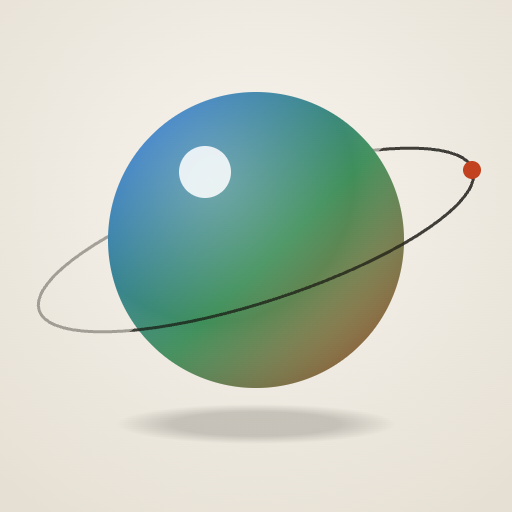
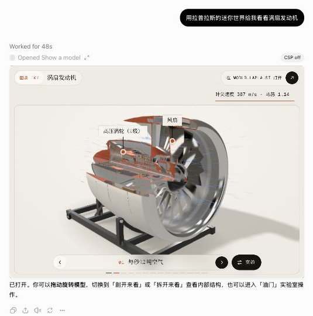
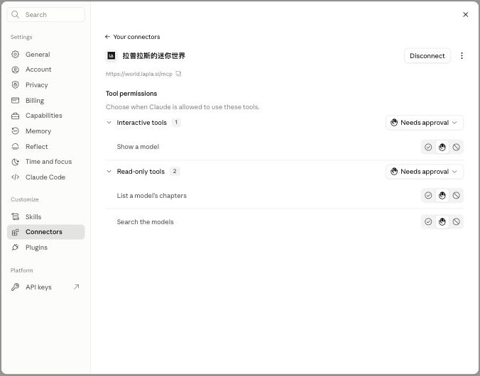
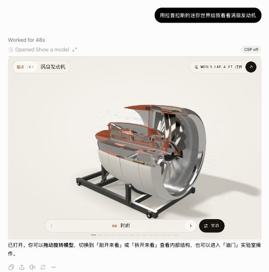
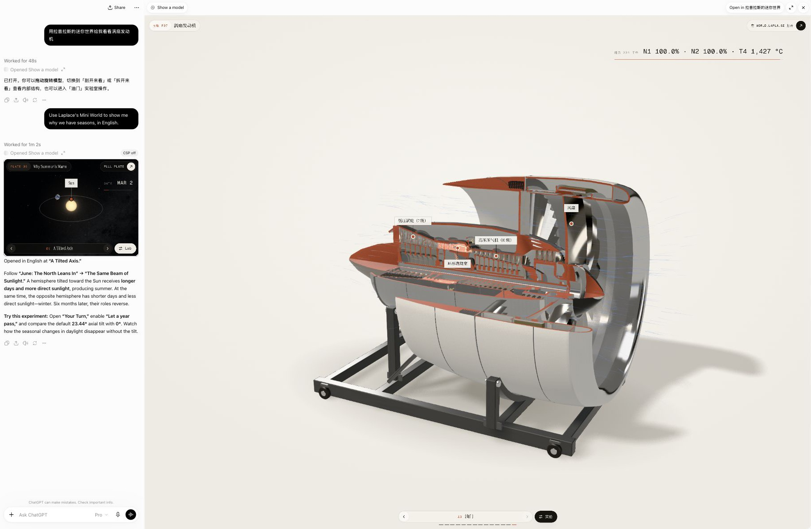
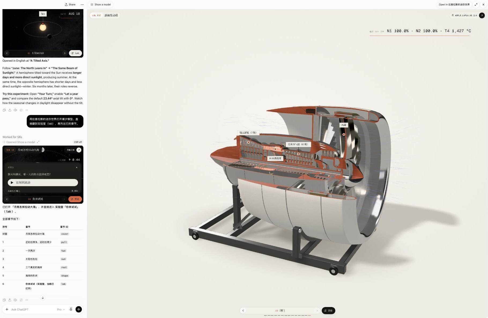

<p align="center"></p>

<h1 align="center">Laplace’s Mini World — MCP server</h1>

<p align="center"><b>English</b> · <a href="README.zh-CN.md">中文</a></p>

Live, interactive 3D science models from [world.lapla.si](https://world.lapla.si/en/), right inside ChatGPT, Claude, Cursor and any other MCP client.

Ask *“why do we have seasons?”*, *“show me how a jet engine works”* or *“用迷你世界给我看看黑洞”*: the assistant finds the right model and puts it in the conversation. Turn it, step through its chapters, and change things in its laboratory, such as the tilt of the Earth’s axis.

```
https://world.lapla.si/mcp
```

No account, no API key, no sign-in. Read-only. Streamable HTTP.

<p align="center">
  
</p>

## What the models are

[world.lapla.si](https://world.lapla.si/en/) (拉普拉斯的迷你世界, Laplace’s Mini World) is a set of over 100 “plates”: each one a working 3D model in the browser, a short illustrated essay with its sources, and a laboratory to try things in. Every plate says what it simplifies. Chinese and English.

| Layer | Halls (plates) |
|---|---|
| Nature | Space (10) · Earth & Sky (13) · Matter, Light & Sound (17) · Life & Medicine (10) |
| Technology | Classic Machines (15) · Energy, Flight & Sensing (8) · Chips & Information (6) · AI (4) |
| Ideas | Mathematics (22) |

Some of them: the seasons, tides, a solar eclipse, a black hole, the Orionids, hurricanes, tsunamis, rainbows, a turbofan, a tokamak, EUV lithography, the Antikythera mechanism, Enigma, a perceptron, attention in a transformer, CRISPR, Fourier series, the Lorenz attractor, the Hopf fibration. The full list is in [`/models.json`](https://world.lapla.si/models.json) and [`/llms.txt`](https://world.lapla.si/llms.txt).

## Tools

All three tools are read-only (`readOnlyHint: true`, `destructiveHint: false`, `openWorldHint: false`, `idempotentHint: true`).

| Tool | Input | What it returns |
|---|---|---|
| `search_models` | `query`, `lang?` (`zh`/`en`), `limit?` (1–10) | The best plates for a topic, with ids and summaries |
| `show_model` | `slug`, `chapter?`, `lang?`, `lab?`, `params?` | The live model as an [MCP Apps](https://modelcontextprotocol.io/extensions/apps) UI, plus a text summary and the plate’s link (text-only clients still get something useful) |
| `list_chapters` | `slug`, `lang?` | A plate’s chapters and its lab settings (ids, ranges, options) |

The server speaks MCP 2026-07-28 (stateless, `server/discover`) and the earlier handshake versions (2025-11-25, 2025-06-18, 2025-03-26). The interactive UI is a `ui://` resource with mimeType `text/html;profile=mcp-app`.

## Connect it

### ChatGPT

1. On chatgpt.com: **Settings → Apps (Plugins) → Add → custom MCP server**. Depending on your plan, this may sit under developer mode.
2. URL: `https://world.lapla.si/mcp`. Authentication: **None**.
3. Ask: *“Use Laplace’s Mini World to show me why we have seasons.”*

### Claude (claude.ai, Desktop, mobile)

1. **Customize → Connectors → Add custom connector**. Custom connectors work on every plan, including Free (one connector).
2. Name: `Laplace’s Mini World` (or 拉普拉斯的迷你世界). URL: `https://world.lapla.si/mcp`. No sign-in.
3. Ask: *“用拉普拉斯的迷你世界给我看看涡扇发动机。”*

<p align="center"></p>

### Claude Code

```sh
claude mcp add --transport http laplace-mini-world https://world.lapla.si/mcp
```

### Cursor

`~/.cursor/mcp.json` (or `.cursor/mcp.json` in a project):

```json
{
  "mcpServers": {
    "laplace-mini-world": { "url": "https://world.lapla.si/mcp" }
  }
}
```

### VS Code (GitHub Copilot)

`.vscode/mcp.json`:

```json
{
  "servers": {
    "laplace-mini-world": { "type": "http", "url": "https://world.lapla.si/mcp" }
  }
}
```

### Gemini CLI

`~/.gemini/settings.json`:

```json
{ "mcpServers": { "laplace-mini-world": { "httpUrl": "https://world.lapla.si/mcp" } } }
```

Gemini doesn’t render MCP Apps UI, so the tools answer in text with the plate’s link.

### Any other client

- Clients that speak Streamable HTTP: point them at `https://world.lapla.si/mcp`.
- Clients that only run local (stdio) servers: bridge with [`mcp-remote`](https://www.npmjs.com/package/mcp-remote):

```json
{
  "mcpServers": {
    "laplace-mini-world": {
      "command": "npx",
      "args": ["-y", "mcp-remote", "https://world.lapla.si/mcp"]
    }
  }
}
```

- Plain HTTP: see [`examples/curl.sh`](examples/curl.sh).

```sh
curl -s https://world.lapla.si/mcp \
  -H 'Content-Type: application/json' \
  -H 'Accept: application/json, text/event-stream' \
  -H 'MCP-Protocol-Version: 2025-06-18' \
  -d '{"jsonrpc":"2.0","id":1,"method":"tools/call","params":{"name":"search_models","arguments":{"query":"black hole","lang":"en"}}}'
```

## Screenshots

| | |
|---|---|
|  |  |
| The turbofan in ChatGPT, asked in Chinese | Stepping to the next chapter |


*The seasons model in English, with the turbofan opened full screen.*


*The tides model opened straight on its laboratory, and its chapters listed by `list_chapters`.*

## The catalog, embed pages and oEmbed

The same data the server uses is public.

### `models.json`

[`https://world.lapla.si/models.json`](https://world.lapla.si/models.json) lists every plate: slug, plate number, title, kicker, summary and description in zh and en, hall and layer, plate and embed URLs, card picture, chapters (with ids), and lab settings (ids, kinds, ranges or options, defaults). [`examples/models.mjs`](examples/models.mjs) searches it from Node:

```sh
node examples/models.mjs tides
```

[`/llms.txt`](https://world.lapla.si/llms.txt) and [`/llms-full.txt`](https://world.lapla.si/llms-full.txt) follow [llmstxt.org](https://llmstxt.org).

### Embed pages

Every model has a page that is just the stage, sized to its frame:

```
https://world.lapla.si/embed/{lang}/{slug}/
```

| Parameter | Effect |
|---|---|
| `chapter=<id>` | Open on that chapter (default: the cover) |
| `lab=1` | Open the laboratory |
| `theme=light` / `dark` | Match the host’s theme (default: the viewer’s system setting) |
| `ui=0` | The model alone, with only the link back |
| `<setting id>=<value>` | A lab setting: a slider’s number, a choice’s option id, a toggle `1`/`0`, `play=1` |

Example: `https://world.lapla.si/embed/en/seasons/?chapter=tilt&theme=dark`

**Where they can be framed.** For now the embed pages may only be framed by world.lapla.si and the AI chat hosts (ChatGPT, Claude). On other sites, link to the plate (`https://world.lapla.si/{lang}/{slug}/`) instead; if you would like to embed a model on your own site or course page, write to contact@lapla.si.

### oEmbed

```
https://world.lapla.si/oembed?url=https://world.lapla.si/en/seasons/&format=json
```

Returns a `rich` answer with the embed iframe and the card picture. Plate pages carry the oEmbed discovery `<link>`.

## Privacy

The server stores and logs nothing about you: no account, no cookies, no sessions. Tool inputs (a search query, a plate id, a chapter id, lab settings) are used only to build the answer. The models shown in a chat run no analytics. See the site’s [privacy page](https://world.lapla.si/en/privacy/).

## MCP Registry

TODO: `server.json` for the [MCP Registry](https://registry.modelcontextprotocol.io) will be added here.

## Licence

- The models, essays, pictures and screenshots: [CC BY-NC 4.0](https://creativecommons.org/licenses/by-nc/4.0/), © Laplace’s Mini World (world.lapla.si). Data sets keep their own licences, named on each plate.
- The example code and configuration snippets in this repository (`examples/` and the code blocks in the READMEs): [MIT](LICENSE).

The server’s source is not in this repository.

## Contact

contact@lapla.si · [world.lapla.si](https://world.lapla.si/en/)
